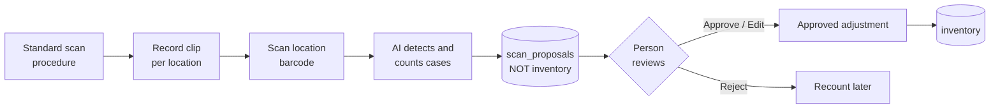
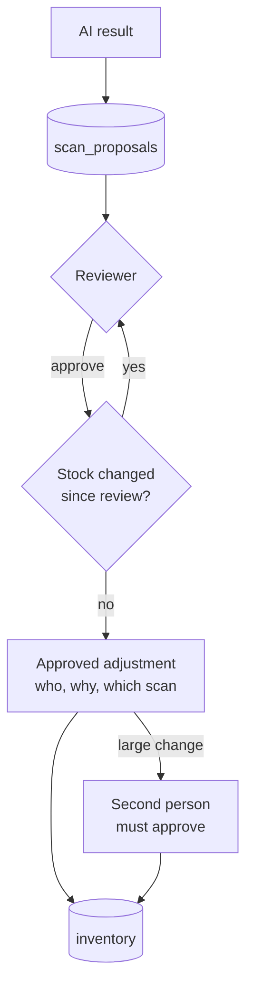
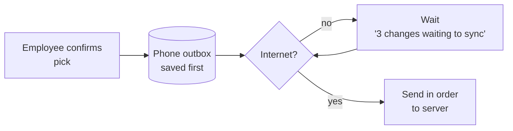
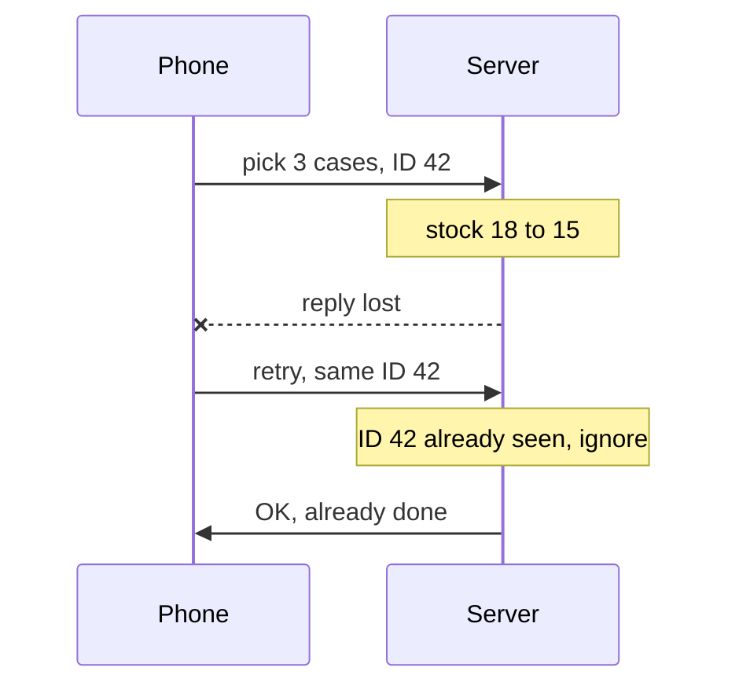
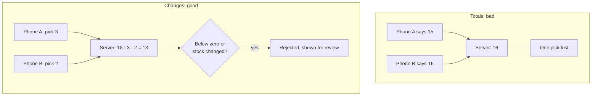
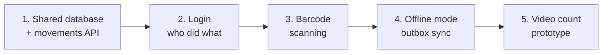

# Walkthrough: Parts 4 and 5, assumptions and next steps

A plain-language version of the written answers, for talking through in the interview. The full answers are in [part4-video-ai.md](part4-video-ai.md) and [part5-offline.md](part5-offline.md). The assumptions and next steps match the [README](../README.md).

---

## Part 4: Shelf-video counting

**One-line pitch:** the AI _suggests_ a count, a person _decides_.

### The ten points in simple words

| #   | Point                    | Simple version                                                                              |
| --- | ------------------------ | ------------------------------------------------------------------------------------------- |
| 1   | Study and standardize    | Write simple scan rules first. A good process beats a smarter model.                        |
| 2   | Capture and processing   | Short clips per location. Pick sharp frames, detect cases, count each case once.            |
| 3   | Location context         | Scan the shelf label. The AI never guesses the location.                                    |
| 4   | Structured output        | AI answers in a fixed JSON form. Invalid form is rejected.                                  |
| 5   | Evaluating accuracy      | 50-100 hand-counted clips. Compare SKU, count and location accuracy.                        |
| 6   | Uncertain results        | "I don't know" is allowed. Small doubt means review, big gap means recount plus supervisor. |
| 7   | Keep AI out of inventory | AI writes only to proposals. Stock changes only through an approved adjustment.             |
| 8   | What to save             | Scans, detections, reviews, adjustments. This becomes training and evaluation data.         |
| 9   | Employee review          | One card per location: frame with boxes, expected vs seen, 4 buttons.                       |
| 10  | Prototype first          | One aisle, 2-3 SKUs, about 30 clips. Measure first, integrate later.                        |

### How to record a shelf clip properly

> **Note:** most counting errors start at recording time, not in the model. Follow these steps for every clip.

| Do                                | Don't                                   |
| --------------------------------- | --------------------------------------- |
| Landscape, steady, one slow pass  | Portrait, shaky, fast or back-and-forth |
| Same distance for the whole clip  | Zoom in and out                         |
| Label visible at the start        | Start mid-shelf                         |
| One clip per location             | One long clip for a whole aisle         |

<b>Full recording steps</b> (before, during, after)

**Before you start**

- Clean the camera lens and check the battery.
- Turn on the phone flashlight if the aisle is dim. Avoid shooting into bright lights or windows.
- Clear anything blocking the shelf (carts, ladders, loose wrap).

**Recording**

1. **Scan the location label first.** Confirm the location shown on screen (for example `A1-R2-S1`) before you press record.
2. **Hold the phone landscape**, at label height, about 1-1.5 m from the shelf. Keep the same distance for the whole clip.
3. **Start at the location label** so it is visible in the first frames.
4. **Pan slowly, left to right, in one pass.** About 2-3 seconds per bay. No zooming, no going back.
5. **Keep the whole case face in view**, top to bottom. Tilt slightly up or down for very high or low shelves rather than stepping closer.
6. **One clip per location.** Stop recording before moving to the next label.

**After recording**

- Check the preview: if it's blurry, dark, or the label isn't readable, re-record right away.
- If cases are hidden behind others, add a note ("2 rows deep, back row hidden"). The AI only counts what it can see.
- No signal? That's fine. The clip is saved on the phone and uploads later.

### Guardrail for inventory

---

## Part 5: Losing internet connectivity

**One-line pitch:** save first, give every change an ID, send changes not totals, and be honest on screen.

### 1. Save on the device first

### 2. No duplicate changes

A retry reuses the same ID, so the server never deducts twice.

### 3. Send changes, not totals

### 4. No confusing results

- The screen says **Live** or **Offline, data from 10:42**.
- Unsynced changes are marked **pending**.
- Pick lists made offline warn that stock may have changed.
- After reconnecting: send the outbox in order, reload inventory, list any rejected change with its reason.

### What the prototype already does

- Confirmed changes are kept in localStorage, and the last snapshot is cached.
- `applyMovements` already skips duplicate IDs.
- The movement log is the seed of the outbox described above.

---

## Assumptions I made

**One-line pitch:** where the brief was silent, I picked the simplest rule a floor employee would expect, and wrote it down.

| Area                | Assumption                                                                                          |
| ------------------- | --------------------------------------------------------------------------------------------------- |
| Walking order       | Aisle numbers follow the walk. Within an aisle, lower rack then lower shelf comes first.            |
| Location codes      | Always `A{aisle}-R{rack}-S{shelf}`, so they can be sorted.                                          |
| Storage             | Storage holds full cases only. Loose units live on the open shelf or in its overflow spot.          |
| Where to pull from  | One location that holds everything if possible (fewer stops), otherwise walk order, lowest aisle first. |
| Short pick lines    | A line that can't be fully filled is not picked at all. It goes to a supervisor; other lines go ahead. |
| Open-shelf data     | Only TURTLE-01 has it. For other SKUs the employee types capacity and current units.                |
| Routing             | A one-way walk by aisle is good enough. No aisle sides, snake routes or packing-station distance.   |
| "Fill the shelf"    | Means reach capacity. Round up (4 cases) and offer round down (3 cases, no opened case).            |
| Overflow units      | Loose units from an opened case are used first at the next replenishment.                           |
| Persistence (demo)  | Changes are saved in the browser only. The server data resets when the server restarts.                      |

---

## Future plans after the demo

**One-line pitch:** make it real for many people first, then make it faster, then add AI.

| #   | Step                     | Simple version                                                                                      | Fixes                                  |
| --- | ------------------------ | --------------------------------------------------------------------------------------------------- | -------------------------------------- |
| 1   | Shared database          | Postgres or Turso with a `movements` table and `POST /api/movements` that ignores duplicate IDs.    | Changes only saved in one browser      |
| 2   | Employee login           | Every movement records who made it. Roles for supervisor approvals.                                 | No record of who confirmed a change    |
| 3   | Barcode scanning         | Scan SKU and location labels with the phone camera instead of typing.                               | Typing errors, slow input              |
| 4   | Offline mode             | The localStorage log becomes a real outbox that syncs when the connection returns (Part 5).        | Dead zones in the warehouse            |
| 5   | Video count prototype    | One aisle, 2-3 SKUs, about 30 clips. Measure accuracy before connecting to inventory (Part 4).      | Manual cycle counts                    |

### Smaller follow-ups

- Screens to add and edit products, locations and stock.
- Better routing: aisle sides, snake-shaped walks, several pickers at once.
- Lock or re-check stock at confirm time, so two people can't take the same cases.
- Move off experimental `node:sqlite` once a hosted database is in place.
