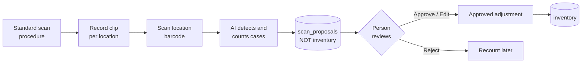
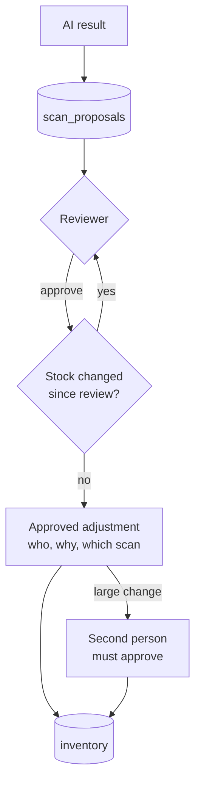
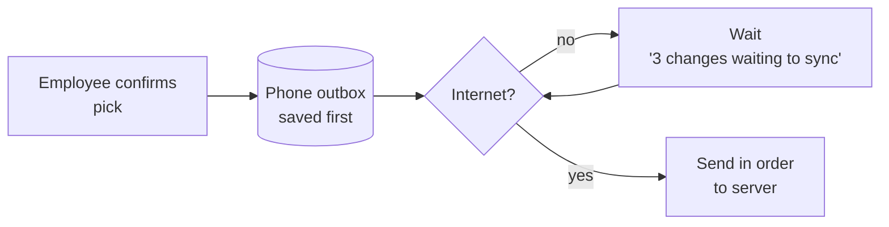
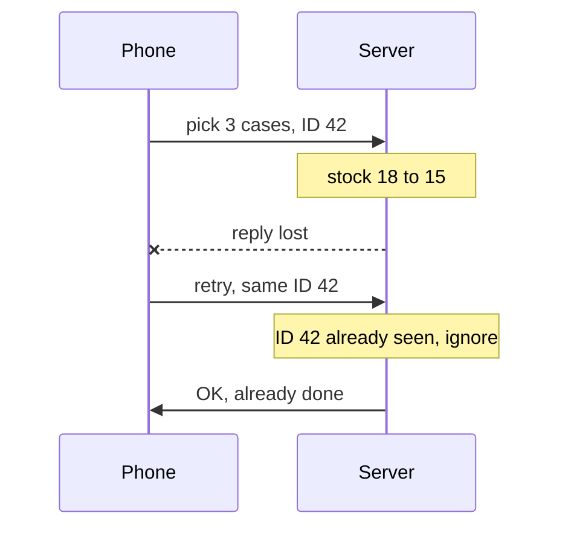
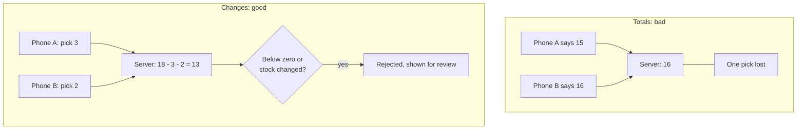

# Interview walkthrough: Parts 4 and 5

A plain-language version of the written answers, for talking through in the interview. The full answers are in [part4-video-ai.md](part4-video-ai.md) and [part5-offline.md](part5-offline.md).

---

## Part 4: Shelf-video counting

**One-line pitch:** the AI *suggests* a count, a person *decides*.

### The ten points in simple words

| # | Point | Simple version |
|---|-------|----------------|
| 1 | Study and standardize | Write simple scan rules first. A good process beats a smarter model. |
| 2 | Capture and processing | Short clips per location. Pick sharp frames, detect cases, count each case once. |
| 3 | Location context | Scan the shelf label. The AI never guesses the location. |
| 4 | Structured output | AI answers in a fixed JSON form. Invalid form is rejected. |
| 5 | Evaluating accuracy | 50-100 hand-counted clips. Compare SKU, count and location accuracy. |
| 6 | Uncertain results | "I don't know" is allowed. Small doubt means review, big gap means recount plus supervisor. |
| 7 | Keep AI out of inventory | AI writes only to proposals. Stock changes only through an approved adjustment. |
| 8 | What to save | Scans, detections, reviews, adjustments. This becomes training and evaluation data. |
| 9 | Employee review | One card per location: frame with boxes, expected vs seen, 4 buttons. |
| 10 | Prototype first | One aisle, 2-3 SKUs, about 30 clips. Measure first, integrate later. |

### Guardrail for inventory

---

## Part 5: Losing internet connectivity

**One-line pitch:** save first, give every change an ID, send changes not totals, and be honest on screen.

### 1. Save on the device first

### 2. No duplicate changes

A retry reuses the same ID, so the server never deducts twice.

### 3. Send changes, not totals

### 4. No confusing results

- The screen says **Live** or **Offline, data from 10:42**.
- Unsynced changes are marked **pending**.
- Pick lists made offline warn that stock may have changed.
- After reconnecting: send the outbox in order, reload inventory, list any rejected change with its reason.

### What the prototype already does

- Confirmed changes are kept in localStorage, and the last snapshot is cached.
- `applyMovements` already skips duplicate IDs.
- The movement log is the seed of the outbox described above.
